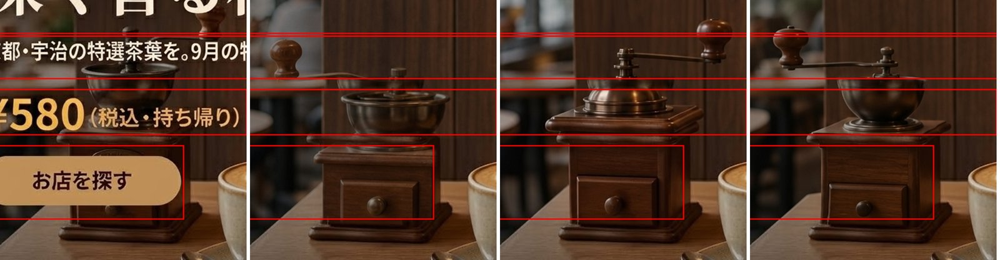
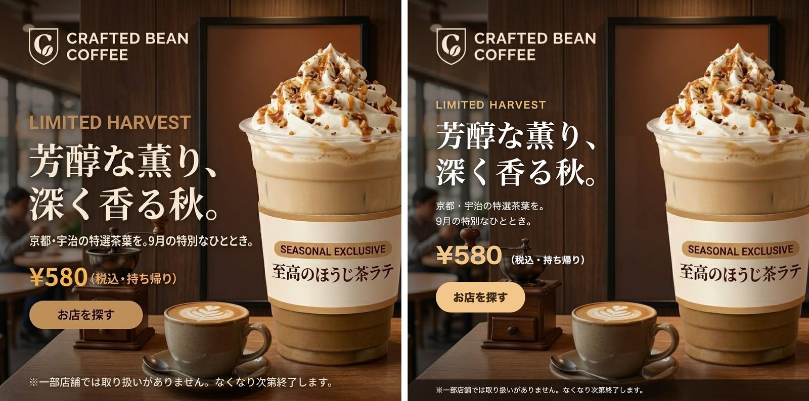
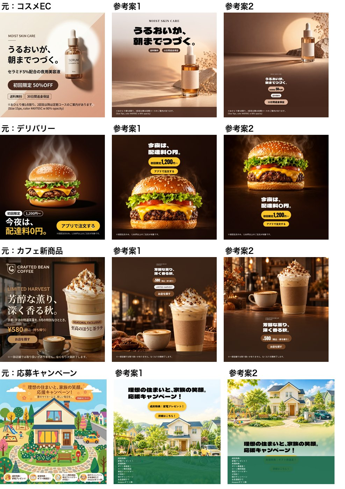
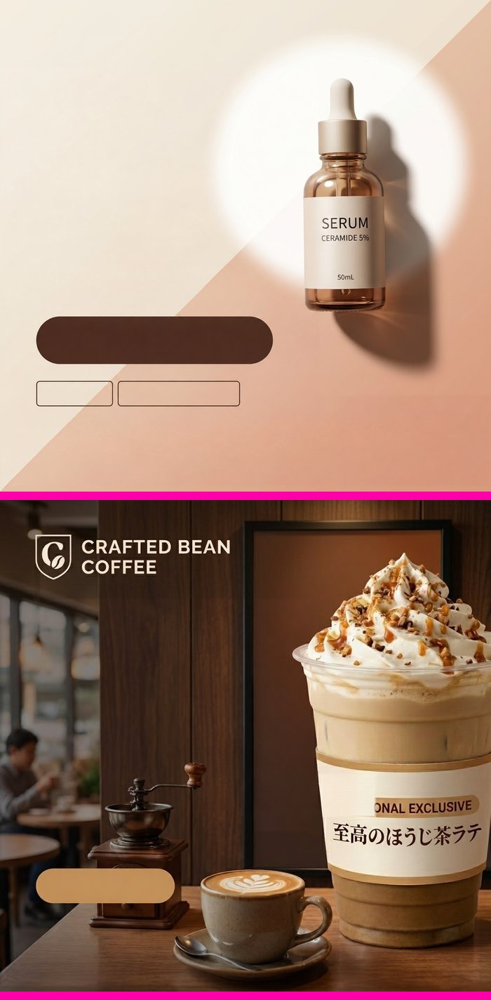
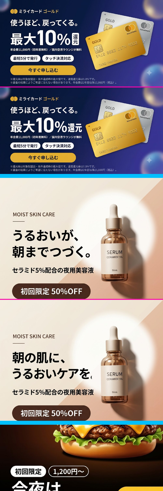
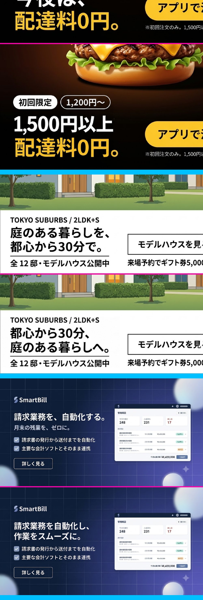
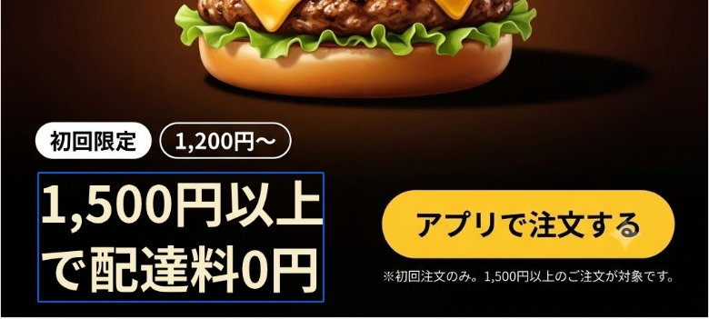

広告バナーをAIで診断するアプリに、「改善したバナーの画像」まで出す機能を足そうとしました。2026年9月27日から29日の3日間で8つの方式を試し、最後は機能ごと外しました。

この記事は、その間に試したこと、測った数字、判断を誤った場面、中断を決めた理由と再開の条件をまとめたものです。うまくいかなかった方式も含めて、同じサンプル13枚で比べています。

## 前提

### アプリ

診断のアプリは、Next.js（App Router）とOpenAIのAPIで作っています。バナー画像を渡すと、AIが所見・コピー案・表現のチェック（景品表示法など）を返します。診断だけでは「どこが弱いか」で終わるので、「こう直すとよい」という画像まで出せれば、課題の指摘から制作の手前までが1つの画面でつながる。これが機能を足そうとした動機でした。

### サンプルと判定の基準

- サンプルは、架空のブランドで作ったバナー13枚です。業種は、化粧品・カード・飲食・不動産・SaaSなどです。
- 判定の基準は「元のバナーより劣化させない」です。途中から、必須の条件にしました。
- 画像の品質の最終判定は、人の目で行いました。13枚という数は、傾向を示す以上のことは言えません。
- クリック率が上がるかは測っていません。この記事は、効果を測った記事ではありません。

### 使ったモデル

| 用途 | モデル |
| --- | --- |
| 診断・画像の中の文字の読み取り・文言の案 | gpt-6-luna |
| 画像の生成・編集 | gpt-image-1-mini、gpt-image-2、gpt-image-2.5（sunburst・flare） |
| 比較のみ | Gemini 3.1 Flash Image（Nano Banana 2） |

モデル名と単価は、2026年9月時点のものです。

## 8つの方式と結果

| 方式 | 条件 | 結果 | エージェントの評価 | 検収 |
| --- | --- | --- | --- | --- |
| 1. AIに文字ごと描き直させる | gpt-image-1-mini、13枚 | 13枚すべてで日本語が崩れた。「月1,000円」が「月1.000円」になった | 使えない | 使えない |
| 2. 文字の跡だけAIに描き直させる | gpt-image-2.5（medium）など | 部分ごとに描き直した物の形が食い違った | 使えない | 使えない |
| 3. 文字だけをコードで組み直す | 注記だけを対象、13枚 | 数値では直せたが、書体が混ざって直した部分だけ浮いた | 限定的 | 使えない |
| 4. 型を使って作り直す | 型4種、13枚×2案 | 測れる劣化が無かったのは26案中10案。元を超えた案は無かった | 使えない | 使えない |
| 5. 指摘の箇所だけAIに直させる | gpt-image-2.5 high、10枚 | 元の書体と配置のまま、注記の拡大やボタンの明暗差を数値の上では直せた | 見込みあり | 使えない |
| 6. 文言の書き換え案（文字だけ） | gpt-6-luna、13枚 | 1回約$0.001。言い換えは元の訴求を整える程度 | 限定的 | 画像を作らないので対象外 |
| 7. 文字を消した下地を作る | gpt-image-2.5 high、13枚 | 背景・写真・ボタンの面が自然につながった | 見込みあり | 使えない（組み直したバナーとして） |
| 8. 見出しをAIで別の文言に書き直す | gpt-image-2.5 high、5枚 | 書体はよく残った。問題が無かったのは5枚中2枚 | 限定的 | 使えない |

検収は、配信するバナーとして使えるかを人の目で判定したものです。バナーの画像を変えた方式は、すべて「使えない」でした。

一方、開発を進めたAIエージェントは、方式5と7を「見込みあり」、方式3と8を「限定的」と評価していました。エージェントは、文言が残っているか、字の大きさと明暗差が基準を満たすか、範囲の外の画素が変わっていないか、という測れる条件で評価していました。測れる条件を満たすことと、使える品質であることは別でした。この食い違いは、後の「判定で誤ったこと」で詳しく書きます。

以下、方式ごとに見ていきます。

### 1. AIに文字ごと描き直させる

最初は、元のバナーと改善の指示を渡して、1枚まるごと描き直させました。安いモデル（gpt-image-1-mini、1回約$0.005、8〜13秒）で13枚を試したところ、13枚すべてで日本語が崩れました。数字も変わり、「月1,000円」が「月1.000円」になりました。商品や人物の形も変わりました。

広告の数字が1つでも変われば、そのまま配信できません。ここで「文字はAIに描かせない」という方針になりました。

### 2. 文字の跡だけAIに描き直させる

次に、文字は後からコードで載せることにして、写真の上の文字だけをAIに消させました。モデルを比べると、gpt-image-2.5 sunburst（medium）が最もよく、1回約$0.022、15〜20秒でした。gpt-image-2（medium）は約3倍の費用で差が無く、flareは指示していない物を描き足しました。

ところが、文字の跡を部分ごとに描き直させると、部分と部分の境目で物の形が食い違いました。

*赤い枠が描き直した範囲。左端が元の画像で、右の3枚は描き直すたびにミルの形が変わっている*

縮小表示では気づきにくく、開発を進めていたAIエージェントは「使える」と判定していました。私が見比べて違和感に気づき、拡大して確かめて分かりました。

### 3. 文字だけをコードで組み直す

AIを使わず、指摘のあった注記だけを、図形の帯で覆ってコードで組み直しました。字の大きさと明暗差は、数値のうえでは基準を満たせました。

ただ、元のバナーの書体とWebフォントが混ざり、直した部分だけが浮いて見えました。元より劣化していて、使えない品質でした。

この方式で分かったことがもう1つあります。診断のAIは「注記は約14px」のように字の大きさを目測で書きますが、画素から測り直すと24pxあった例がありました（cafe）。目測のまま直すと、逆に小さくなります。直すかどうかは、コードで測った値で決めることにしました。

### 4. 型を使って作り直す

バナーの構成を型（4種）に当てはめ、背景の下絵をAIに作らせ、文字はコードで組む方式です。13枚×2案＝26案を作りました。

数字や見出しの欠落、文字の縮小のような測れる劣化が無かったのは26案中10案でした。見た目で元を超えたと判断できた案はありませんでした。型に流し込むと、どのバナーも「整った定型」になり、元のバナーの個性が消えました。

下絵のモデルも比べました。同じ指示で、Gemini 3.1 Flash Imageは1枚約$0.067・約10秒、gpt-image-2.5 sunburst（medium）は1枚約$0.009・約15秒でした。どちらも、文字に見える模様（擬似文字）は0でした。

### 5. 指摘の箇所だけAIに直させる

方式を変えました。元の画像ごとgpt-image-2.5（quality high）に渡し、「この注記を大きく」「このボタンの明暗差を上げて」のように、直す箇所だけを指示します。

測れる数値の上では、これは効きました。元の書体と配置のまま、注記を大きくしたり、ボタンの明暗差を上げたりできました。ただし検収では、配信できる品質ではないと判定しました。

ただ、AIは指示していない部分も描き直していて、画素の約5%が意図せず変わりました。そこで、直した箇所の周りだけを元の画像に貼り戻し、それ以外は元の画素のまま残すようにしました。

貼り戻す範囲を固定すると、別の失敗が起きました。文字を1.3倍にすると行が横に伸び、決まった範囲で貼り戻すと文末が切れました（「〜ありませ」「（税込」で途切れた）。注記は法定表記のことがあるので、切れてはいけません。範囲を「AIが実際に変えた所まで」広げて解決しました。

エージェントの「見込みあり」という評価をもとに、この方式を診断レポートの中の「α版・検証中」として一度公開しました。

### 6. 文言の書き換え案

ここで、根本的な問題に気づきました。これはただのアクセシビリティの検査ではないか、ということです。字の大きさと明暗差の修正は、コンバージョンを上げる改善ではありません。

そこで、訴求の文言そのものの別案を出す機能を足しました。画像は作らず、読み取った見出し・バッジ・ボタンごとに、所見に応える言い換えを2つ出します。1回約$0.0005〜0.0011でした。

広告の文言をAIに書かせるときの問題は、根拠の無い数字や主張を足すことです。「最大20%還元」「業界No.1」「今だけ」のような案を、サーバーで機械的に落とすようにしました。

- 元の文言に無い数字は落とす。全角と半角を揃え、桁区切りのカンマを消してから比べる
- 単位つきの数量は、単位ごと照合する。数字だけで照合すると、元の「1回」の1で、作った「1点限り」が通った
- 「No.1」「最安」「限定」「無料」のような語は、同じ語が元の文言に無ければ落とす

検査には、落とすべき案と残すべき案の両方をテストとして持たせました。落とす側だけで作ると、正しい案まで落としていても気づけないためです。

言い換えの質は、元の訴求を整える程度にとどまりました。安全な言い換えにはなりますが、クリックを大きく変えるほどの案にはなりませんでした。

### 7. 文字を消した下地を作る

構図まで変える改善には、バナーを「背景」と「文字」に分けて組み直す道具が要ります。その最初の部品として、文字だけを消した下地をAIに作らせました。

下地だけを見ると、自然に見えます。ただしこれは部品で、この上に文字を組み直したバナーは、検収で使えないと判定しました。

13枚とも、背景・写真・ボタンの面が自然につながりました。ただし、そこに至るまでに貼り戻しの範囲で2回つまずきました。

- 読み取りの矩形は、複数行の2行目を取りこぼす。そのまま貼り戻すと、5枚中4枚で元の文字が一部残った。AIの目測の矩形と、画素から補正した矩形の和をとると漏れなくなった
- 範囲を「AIが変えた所まで」広げると（方式5で使ったやり方）、AIが勝手に消した商品のラベルやロゴまで取り込んだ。AIは「ラベルは残して」と指示しても消すことがある。守る範囲は、AIの出力を信用せず元の画素に戻す

方式5で効いた工夫が、ここでは逆に働きました。同じ「貼り戻し」でも、直す処理と消す処理では、守るべきものが違いました。

費用は、横長の画像で1回約$0.036〜0.041、正方形で約$0.083〜0.085でした。

### 8. 見出しをAIで別の文言に書き直す

下地に文字を載せ直すと、書体が元と変わります（方式3の問題）。そこで、見出しだけをAIに別の文言で書き直させてみました。

書体と太さは、5枚ともかなり正確に元と揃いました。ただし、問題が無かったのは5枚中2枚でした。

- 指定した「で」が抜け、元に無い「。」が付いた（デリバリー）
- 貼り戻す範囲が足りず、文末の「。」が欠けた（化粧品）
- 見出しを2行にした代わりに、すぐ下の補足の見出しが消えた（SaaS）

検収では、使えないと判定しました。仮に使うとしても、書き直した文言が一字一句同じか、他の要素がすべて残っているか、範囲のすぐ外が変わっていないかを毎回検査し、1つでも落ちたら捨てる必要があります。

## 組み直しの道具（β）

方式7の下地を使って、ブラウザの中で文字の層を組み直す道具を作りました。文言・字の大きさ・色・位置を変えられ、書き換え案をそのまま層に当てられます。

この道具で組み直したバナーも、検収では使えないと判定しました。

劣化を防ぐ仕組みとしては、次のことを毎回確かめるようにしていました。検収に通らなかった以上、これらは「元を壊さない」ことの保証で、「使える」ことの保証ではありません。

| 守ること | 確かめ方 |
| --- | --- |
| どの層も触っていなければ、元の画像と同一 | 元の画像のデータそのものを出す |
| 変わる画素は、触った層の範囲の中だけ | 描くたびに範囲の外で変わった画素を数え、0でなければ警告する |
| ロゴ・商品の文字・画面の見本は元のまま | 触った層の範囲の中にあっても、元の画素に戻す |
| 組み直した文字が、他の要素に重ならない | 描くたびに重なりと画像の外へのはみ出しを調べる |

1つ目は、最初はcanvasに元の画素を描いて書き出していました。ところが、元の画像と比べると約221万の値のうち27万6,735が1ずつずれていました。JPEGを読み込む経路が違うことによる丸めの差です。目には見えない差ですが、「触っていなければ元と同一」を厳密に守るため、触っていないときは元のデータをそのまま渡すようにしました。

## 費用

| 処理 | 1回の費用 | 時間 |
| --- | --- | --- |
| 文字の読み取り（gpt-6-luna） | 約$0.001 | 10〜20秒 |
| 文言の書き換え案（gpt-6-luna） | 約$0.0005〜0.0011 | 10〜17秒 |
| 画像の修正・文字消し（gpt-image-2.5 high、正方形） | 約$0.085 | 30〜45秒 |
| 同上（横長） | 約$0.036〜0.042 | 20〜30秒 |
| 下絵（gpt-image-2.5 medium） | 約$0.009 | 15〜25秒 |
| 下絵（Gemini 3.1 Flash Image） | 約$0.067 | 約10秒 |

画像を作る処理の費用は、画像の形で2倍以上変わりました。最初に横長の画像3枚だけで費用の目安を決めていたため、正方形では約2.4倍の過小になっていました。1日の上限も、30回のままでは正方形ばかりで1日約$2.5になり、予算の$1を超えていました。気づいて10回に下げました。

検証全体で使った費用は、約$4.26でした。方式ごとの内訳は次のとおりです。金額は、APIが返したトークン数に公式の単価を掛けたもので、請求書の金額ではありません。

| 方式 | 回数・枚数 | 費用 |
| --- | --- | --- |
| 1. 文字ごと描き直す（gpt-image-1-mini） | 33回 | 約$0.16 |
| 2. 文字の跡を描き直す（モデル比較） | 18回 | 約$0.59 |
| 3. コードで組み直す | 文字の読み取りのみ | ほぼ0 |
| 4. 型で作り直す（下絵・Geminiとの比較・参考案26案） | 下絵とその検査 | 約$0.91 |
| 5. 指摘の箇所だけ直す | 13回 | 約$0.66 |
| 6. 文言の書き換え案 | 53回 | 約$0.04 |
| 7. 文字を消した下地 | 24枚 | 約$1.56 |
| 8. 見出しを別の文言に書き直す | 5回 | 約$0.33 |
| 診断・文字の読み取りの確認 | 数回 | 約$0.01 |

方式4には、画面での確認の分として推定の約$0.15を含みます。それ以外は、スクリプトが出力したトークン数からの計算です。最も費用がかかったのは方式7で、全体の約37%でした。正方形の画像が多いと、1枚あたりの単価が上がるためです。

## 判定で誤ったこと

開発は、AIのコーディングエージェント（Claude Code）と進めました。画像の出来について、エージェントの評価と人の検収が何度も食い違いました。

- 縮小表示で「使える」と判定した画像が、拡大するとミルの形が崩れていた（方式2）
- 途中の工程（下絵）の出来で「使える」と書いたが、最終成果物（文字を載せたバナー）では品質が足りなかった（方式3・4）
- 測れる条件をすべて満たした方式5と7を「見込みあり」と評価したが、検収ではどちらも使えなかった

3つ目がいちばん大きな食い違いでした。エージェントは、文言の照合、字の大きさと明暗差、範囲の外の画素の変化を検査し、どれも通っていることを根拠に「見込みあり」としていました。これらの検査は、劣化が無いことは示せても、バナーとして使える品質であることは示せません。デザインの品質は、測れる条件の外にありました。

ここから、次の3つを決めました。

- 判定は、配信するバナーとして見たときの品質で行う。途中の工程の出来で「使える」と書かない
- 測れる条件を満たしたことを、使える品質の根拠にしない。エージェントの評価は「測れる範囲で問題が無い」までにとどめる
- 境目は2倍以上に拡大して確かめる。最終判定は、人の目に任せる

## なぜグラフィックの改修は失敗したか

失敗の原因は、大きく2つに分けられます。

### 1つ目: バナーは0.1秒で受け取られる、全体の形だった

バナーは、人がじっくり読むものではありません。一瞬で目に入り、本能的に反応されるグラフィックの集まりです。動物がヘビや火、天敵に一瞬で反応するのと同じ種類の反応です。視覚の研究も、この見方と矛盾しません。

| 研究 | 分かっていること |
| --- | --- |
| [Thorpe et al., 1996（Nature）](https://www.nature.com/articles/381520a0) | 20msだけ見せた写真に動物がいるかを、脳は150ms以内に判断している |
| [Lindgaard et al., 2006（Behaviour & Information Technology）](https://www.tandfonline.com/doi/abs/10.1080/01449290500330448) | Webページの見た目の好ましさは50msで評価され、500ms見たときの評価と強く相関する |
| [Pieters & Wedel, 2012（Marketing Science）](https://dl.acm.org/doi/10.1287/mksc.1110.0673) | 広告は、100ms未満の1回の注視の粗い見え方だけで、広告であることや何の商品かが分かる |
| [Van Le et al., 2013（PNAS）](https://www.pnas.org/doi/10.1073/pnas.1312648110) | サルの視床枕のニューロンは、ヘビの画像に顔や図形より速く強く反応する。反応したのは細部を消した低周波の画像で、細部だけの高周波の画像には反応しなかった |

どの研究も、最初の一瞬の反応を決めるのは、細部ではなく全体の粗い形だと示しています。

今回、AIエージェントが行ったのは、その逆でした。注記の字が18px未満だから大きくする、明暗差が4.5:1未満だから濃くする、見出しを型の区画に収める、というように、要素を1つずつ測り、論理で動かしていました。細部の数値は良くなっても、0.1秒で受け取られる全体の形が崩れます。測れる条件をすべて満たした方式が、人の目では一目で「使えない」と判定されたのは、このためだと考えています。

なお、上の研究が示しているのは、判断の速さと、粗い全体の形で処理されることまでです。「論理で配置を動かすと失敗する」ことを直接確かめた研究ではありません。それを示しているのは今回の検証の結果で、研究はその説明と矛盾しない、という関係です。

### 2つ目: プロンプトとデザインの判断を、AIに委ねていた

画像を作るプロンプトも、型も、書体も、グラフィックデザインの専門家ではなく、AIエージェントが考えていました。一瞬の反応を起こすグラフィックを作るには、十分な経験と専門の知識が要ります。構図と見た目の品質が検収に通らなかった大きな原因は、ここにあったと考えています。

ただし、次の失敗は、プロンプトの出来とは関係なく起きていました。

- 日本語の字が崩れ、数字が変わった（方式1）。モデルの能力の限界です
- 指示していない部分の画素が約5%変わった（方式5）。AIの画像編集の性質です
- 1回$0.04〜0.085の費用がかかった

また、「専門家がプロンプトを書けば検収に通る」かどうかは、今回は確かめていません。言えるのは「専門家なしでは通らなかった」までです。

## それではどうすればよいか

実際に成果を出している事例は、どれもAIにデザインを丸ごと任せていませんでした。

| 事例 | 人が担うこと | AIが担うこと |
| --- | --- | --- |
| [サイバーエージェント「極予測AI」](https://logmi.jp/main/technology/330700) | 企画、素材の制作、品質の判断 | 効果の予測と、素材の生成の補助。広告を丸ごと自動生成してはいない。この形で、クリエイターの制作量が約4.5倍になったと発表している |
| [パルコ「HAPPY HOLIDAYS」（2023）](https://prtimes.jp/main/html/rd/p/000002679.000003639.html) | クリエイティブディレクターとデジタルクリエイターが制作を率いた | 人物・背景・映像・ナレーション・音楽の生成 |
| [Canvaのブランドテンプレート](https://www.canva.com/help/create-on-brand-designs/) | ブランドデザイナーが、テンプレートと色・書体・ロゴを作り、編集できないようにロックする | テンプレートの中の文言と画像の生成 |
| [Metaの生成AI広告ツール](https://about.fb.com/news/2024/09/metas-ai-product-news-connect/) | 広告主が元の広告を作る | 背景の生成、画像の拡張、文言の別案 |

Metaは、生成AIの機能を使ったキャンペーンは、使わないものよりクリック率が11%、コンバージョン率が7.6%高かったと発表しています。ただしこれはMeta自身の発表で、どの機能による効果かの内訳は示されていません。

これらの事例と今回の結果から、進め方は次の3つにまとめられます。

1. デザインは専門家が持つ。0.1秒で反応を起こす全体の形（構図・書体・色）は、デザイナーが作ってロックする。AIには、その枠の中の差し替え（文言の別案、背景の別案）だけを任せる
2. 文字はAIに描かせない。日本語と数字は、制作ツールの中で本物の文字として組む
3. AIは、予測と言葉に使う。今回のアプリの役割は、診断（課題の抽出）とコピー案までにとどめ、制作はデザイナーとCanva・Figmaのような制作ツールに渡す

「専門家がプロンプトや型を作れば、AIの生成でも検収に通るか」は、少ない費用で確かめられます。デザイナーがプロンプトか型を書き、サンプル3枚で同じ手順を回して、同じ人が検収する。これを次の検証にします。

## 中断の判断

3日間の結果を並べると、バナーの画像を変えた方式で、検収に通ったものはありませんでした。測れる劣化を出さずに変えられたのは文言・字の大きさ・色・位置まででしたが、それも配信できる品質にはなりませんでした。コンバージョンに効く構図・写真・訴求の組み立ては、AIに描き直させると元より劣化しました。

一方で、画像を作る処理は1回約$0.04〜0.085かかります。1日の予算を$1とすると、正方形なら1日約11回しか使えません。検収に通る結果が出ないまま1回ごとに費用がかかるので、費用対効果が見合わないと判断しました。素材を分けて組み直す作業は、CanvaやFigmaのような制作ツールの領分で、診断アプリの中に作り込む利点も小さい、という判断です。

画像生成まわりのコードは画面から外し、アプリは元の診断に戻しました。コードはgitの履歴に残してあります。

## 再開する条件

モデルの進歩で、次のどれかが満たされたら再開を検討します。

1. 日本語の文言を一字一句正しく描ける。サンプル13枚で見出しを別の文言に書き直させ、13枚すべてで指定どおりに読み取れること
2. 画像を直す1回の費用が、正方形で$0.02以下になる。1日$1で約50回使える水準
3. 指示していない部分を描き直さない。貼り戻しをせずに、指示した範囲の外で変わる画素が0.5%未満になること
4. 制作ツールに、下地と文字の層を渡せる
5. デザイナーが作ったプロンプトか型で、サンプル3枚が同じ人の検収に通る。モデルの条件より先に、この条件を確かめる

## まとめ

- 日本語の文字をAIに描かせると崩れる。数字も変わる。描かせるなら、一字一句の照合が要る
- AIの画像編集は、指示していない部分も描き直す。元を残したい部分は、貼り戻しで守る
- 貼り戻す範囲の決め方は、直す処理と消す処理で違う。ロゴや商品のラベルは、AIの出力を信用せず元の画素に戻す
- 画像の形で費用が2倍以上変わる。費用の目安は、形ごとに実測して最大の側で出す
- 縮小表示では劣化が見えない。判定は最終成果物で、拡大して行う
- 測れる条件を満たすことと、使える品質であることは別。AIエージェントの「見込みあり」は、人の検収の代わりにならない
- バナーは0.1秒で受け取られる全体の形。要素を1つずつ論理で動かすと、その形が崩れる
- デザインの枠は専門家が持ち、AIには枠の中の差し替えと、予測・言葉を任せる

今のモデルと進め方では、バナーのグラフィックを、検収に通る品質で直すことはできませんでした。3日間で約$4.26を使って確かめられたのは、どの方式がどこで崩れるかと、測れる検査では0.1秒の反応の品質を保証できないということでした。
