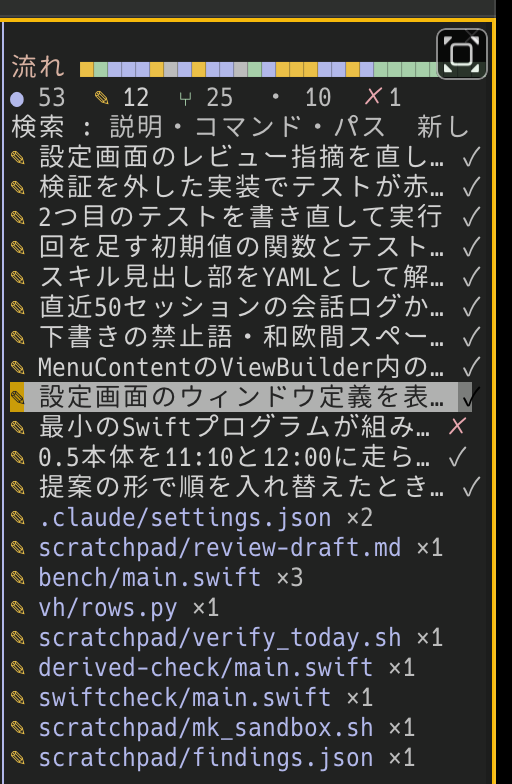

## modとは

Claude Codeのmodは、Claude Code自身の画面や動きに手を加える小さな拡張です。TypeScriptで書いたファイルを決まったフォルダに置くと、Claude Codeがそれを読み込みます。作れるものは、画面の横や入力欄の上に出すパネル、入力欄の上の1行の表示、ステータスライン、スラッシュコマンド、ツールを実行する前後の処理などです。

この記事では、Claude Codeが実行したコマンドと変更したファイルを、色分けした一覧としてパネルに出すmod「work-log」を作ります。modを作ったことがない人が、最初の1つを動かすところから配布するところまでを順に追えるように書きました。

なお、modの仕組みは早期提供の段階にあり、予告なく変わることがあると型定義のファイルに書かれています。この記事はClaude Code 2.1.296で確かめた内容です。

## 作るもの



画像は、この記事を書いて公開するまでの作業を記録したパネルです。

Claude Codeに作業を任せていると、コマンドの実行やファイルの変更が会話の中を流れていき、いま何をしているのか、どこで失敗したのかを後から追いにくくなります。work-logはこれを1枚のパネルにまとめます。

パネルの1行目には、実行したコマンドを1件1マスで古い順に並べます。マスの色はコマンドの種類（調べる、書き換え、検証、git、その他）で分け、失敗したものは赤の「✗」にします。色の並びを見ると、作業がいま調べる段階なのか、書き換えや検証の段階なのかが分かります。その下に、コマンドの一覧と変更したファイルの一覧を左右に並べます。幅が狭いときは上下に並べます。行を押すと、コマンドと結果の先頭が開きます。

## 最小のmodを動かす

modは次の3つのファイルでできています。

```
work-log/
├── .claude-plugin/plugin.json
└── hooks/
    ├── hooks.json
    └── register.tsx
```

`plugin.json`はmodの名前と説明です。

```json
{ "name": "work-log", "version": "0.2.0", "description": "変更したファイルと実行したコマンドを横のパネルに一覧で出す" }
```

`hooks.json`は、読み込むファイルを指します。

```json
{ "modules": ["./register.tsx"] }
```

`register.tsx`が本体です。最初は、`/work-log`と打つとパネルを開くだけのものを書きます。

```tsx
import type { Register } from 'claude-code'

export const register: Register = on => {
  on('session.start', async ($, e, next) => {
    await $.command.register({ name: 'work-log', description: '作業の記録をパネルに出す' })
    return next(e)
  })

  on('command.run', { command: 'work-log' }, async $ => {
    await $.ui.open({ id: 'work-log', title: '作業の記録' })
    return { text: '作業の記録を開きました' }
  })

  on('ui.render', { component: 'Pane', requestId: 'work-log' }, async ($, e) => {
    const { Text } = $.ui.resolve(e)
    return <Text>まだありません</Text>
  })
}
```

`on(イベント名, 条件, 処理)`で処理を登録します。処理は`($, e, next)`の3つを受け取ります。`$`はClaude Code側の機能の入り口、`e`はイベントの中身、`next(e)`はClaude Code本来の処理です。`next(e)`を呼べば本来の動きに任せ、呼ばずに値を返せば、その値で答えたことになります。

modは、DOMもNode.jsも無い専用の環境で動きます。画面に描く部品（`Box`、`Text`、`Button`など）は`$.ui.resolve(e)`から受け取ります。

読み込み方は2つあります。開発中は、Claude Codeに「modを作りたい」と頼むと、セッション専用の開発用フォルダに書かれ、保存するたびに読み込み直されます。普段使いにするときは、任意のフォルダに置いて、設定の`CLAUDE_CODE_PLUGIN_DIRS`にその場所を足します。

## ツールの実行を記録する

Claude Codeがツールを実行するたびに`tool.call`というイベントが起きます。`next(e)`の前後で記録すれば、実行中と実行後の両方を捉えられます。

```tsx
import { atom, update } from 'claude-code'

const commands = atom({ plugin: 'work-log', key: 'commands' } as const, [] as CommandEntry[])

on('tool.call', async ($, e, next) => {
  if (e.tool !== 'Bash') return next(e)

  const entry = { id: e.tool_use_id, command: e.command, description: e.description ?? '', state: 'runs' }
  await update($, commands, list => [...list, entry].slice(-100))

  const ran = await next(e)
  const state = ran.deny === undefined && ran.isError !== true ? 'ok' : 'failed'
  await update($, commands, list => list.map(one => (one.id === entry.id ? { ...one, state } : one)))
  return ran
}).catch(($, e, next) => next(e))
```

記録はモジュールの変数ではなく、`atom`で`$.state`に持たせます。modは保存のたびに読み込み直され、そのときモジュールの変数は初期値に戻ります。`$.state`の値はClaude Code側が持っているので、読み込み直しても消えません。

最後の`.catch`は、記録の処理が失敗したときにも`next(e)`へ進めるためのものです。これが無いと、modの不具合でコマンドの実行そのものが止まることがあります。

`$.state`に持つ値は、型の定義ファイルで宣言します。

```ts
declare module 'claude-code' {
  interface PluginState {
    'work-log': { files: FileEntry[]; commands: CommandEntry[]; selected: string }
  }
}
```

`Bash`の入力には、Claude Codeがコマンドごとに付ける説明（`description`）が入っています。一覧にはコマンドそのものではなく、この説明を出します。最初の版ではコマンドの1行目を出していましたが、`D=/Users/...`のような準備の行が並ぶだけで、何をしたのかが読めませんでした。

## パネルに描く

パネルの中身は`ui.render`で描きます。記録を`read`で読むと、記録が更新されたときに描き直されます。

```tsx
import { atom, read, update } from 'claude-code'

on('ui.render', { component: 'Pane', requestId: 'work-log' }, async ($, e) => {
  const { Box, Text } = $.ui.resolve(e)
  const list = await read($, commands)
  // パネル本体に収まる行数
  const rows = e.props.scroll.bodyRows

  return (
    <Box flexDirection="column">
      {list.slice(-(rows - 1)).map(one => (
        <Text>{one.description}</Text>
      ))}
    </Box>
  )
})
```

行数の計算で一度失敗しました。最初は端末全体の高さ（`e.viewport.rows`）を基準に、コマンドとファイルの一覧を上下に半分ずつ割り当てていました。ところが端末の幅が狭いと、パネルは画面の横ではなく入力欄の上に3行ほどの高さで出ます。下の段がはみ出して隠れ、ファイルの一覧しか見えませんでした。パネル本体の行数（`e.props.scroll.bodyRows`）と幅（`e.props.bodyColumns`）を基準にし、幅が十分あるときは左右に並べる形に直しています。

## 押して開く、色で分ける

一覧の各行を`Button`にすると、クリックでも、矢印キーで選んでEnterでも押せます。`plain`を付けると、ボタンの枠を描かずに文字だけで出ます。

```tsx
const selected = atom({ plugin: 'work-log', key: 'selected' } as const, '')
const toggle = (id: string) => () => update($, selected, now => (now === id ? '' : id))

<Button plain key={`c:${one.id}`} onPress={toggle(`c:${one.id}`)}>
  <Text color={KIND_COLOR[one.kind]}>●</Text> {one.description}
</Button>
```

開いている行を`$.state`に持ち、開いているときは一覧の代わりにコマンド（8行まで）と結果の先頭3行を描きます。同じ行をもう一度押すと閉じます。

コマンドの種類は、中身を正規表現で見て決めています。検証（`test`、`tsc`など）、git、書き換え（`sed -i`、`cp`など）、調べる（`ls`、`grep`など）の順に当てはめ、どれにも当たらなければ「その他」にします。

```ts
export const classify = (command: string): Kind =>
  CHECK.test(command) ? 'check'
  : GIT.test(command) ? 'git'
  : WRITE.test(command) ? 'write'
  : READ.test(command) ? 'read'
  : 'other'
```

色には、`suggestion`や`warning`のようなClaude Codeのテーマの色の名前を使います。色を直接指定しないので、明るいテーマでも暗いテーマでも読める色になります。

## 秘密の値を画面に出さない

work-logは、実行したコマンドとその結果を画面に出します。コマンドにトークンやパスワードが含まれていると、それもそのまま出ます。画面を共有している場面では漏れにつながるので、記録する前に伏せ字にします。

```ts
export const mask = (text: string): string => {
  let out = text
  for (const pattern of PATTERNS) out = out.replace(pattern, '•••')
  out = out.replace(URL_USERINFO, '$1•••@')
  out = out.replace(BEARER, (_m, kind) => `${kind} •••`)
  out = out.replace(FLAG, (_m, flag) => `${flag}•••`)
  out = out.replace(NAMED, (_m, name, sep) => `${name}${sep}•••`)
  return out
}
```

伏せる対象は、よく知られた形式のトークン、`Bearer`の後ろの値、`--password=`のような指定、名前に`TOKEN`や`SECRET`を含む代入の値、URLに埋め込んだ認証情報、秘密鍵のブロックです。結果も先頭3行・300字までしか持ちません。

正規表現による伏せ字は、すべての秘密の値を見つけられるわけではありません。対象にした形式をテストで固定し、どこまでを伏せるのかを説明書に書いています。

## テストと検証

modの確認には、Claude Codeに付属する3つの手段を使います。

`claude plugin validate <フォルダ>`は、modの設定と本体を読み、どのイベントに処理を登録しているか、どの機能を呼んでいるかを一覧にします。work-logでは、呼んでいる機能が「コマンドの登録」「パネルを開く」「`$.state`の読み書き」だけだと確かめられます。ファイルの読み書きや外部への通信をしていないことの確認にもなります。

`claude plugin test <フォルダ>`は、`*.test.ts`をClaude Code本体の上で動かします。テストの中で`$.tool.call`を呼ぶとmodの`tool.call`が動き、`$.ui.mount`でパネルを描いて中身を探せます。

```ts
test('秘密の値は伏せ字で記録され、パネルにも出ない', async ($, on) => {
  on('tool.call', { tool: 'Bash' }, () => ({ result: { stdout: 'ok', stderr: '', interrupted: false } }))

  await $.tool.call({ tool: 'Bash', command: 'curl -H "Authorization: Bearer exampletoken123456" https://example.com', description: '例の取得' })
  const ui = await $.ui.mount({ plugin: 'work-log', surface: 'terminal', component: 'Pane', requestId: 'work-log', props: pane })
  const row = await ui.find({ type: 'Button', text: /例の取得/ })
  await ui.press({ key: row?.key ?? '' })

  expect(await ui.find({ text: /exampletoken123456/ })).toBeUndefined()
  expect(await ui.find({ text: /Bearer •••/ })).toBeDefined()
})
```

`$.tool.call`の引数は、ツールの入力を`input`で包まずに並べて書きます。最初に`{ tool: 'Bash', input: { command } }`と書いたところ、modの側で`e.command`が`undefined`になって描画が止まりました。

型検査は`tsc -p <フォルダ>`です。modが一度読み込まれると、Claude Codeが型の定義と`tsconfig.json`をmodのフォルダに置くので、そのまま実行できます。手元ではTypeScript 5.6だと型が深すぎるという理由で通らず、5.9では通りました。

## 配布する

work-logは[BoxPistols/claude-work-log](https://github.com/BoxPistols/claude-work-log)で公開しています。

modのリポジトリに`.claude-plugin/marketplace.json`を置くと、使う人は次のコマンドで入れられます。

```
/plugin install work-log --marketplace BoxPistols/claude-work-log
```

`marketplace.json`には、リポジトリの名前と、そこに入っているmodの一覧を書きます。

```json
{
  "name": "claude-work-log",
  "description": "実行したコマンドと変更したファイルをパネルに出すmod",
  "owner": { "name": "BoxPistols" },
  "plugins": [{ "name": "work-log", "source": "./" }]
}
```

Claude Codeがmodを読み込むたびに書く型の定義（`.claude-plugin/types/`）は、`.gitignore`でリポジトリから外しています。

## 初めて手を入れる人向けのissue

work-logのリポジトリには、初めて手を入れる人が取り組みやすいissueを[good first issue](https://github.com/BoxPistols/claude-work-log/labels/good%20first%20issue)として用意しています。

- 種類分けに、よく使うコマンドを足す
- 伏せ字にする形式を足す
- 英語の表示に切り替えられるようにする
- ファイルの詳細に、変更した行数を出す

どれもファイル1つと、テスト1つで完結する大きさです。modを作ってみたい人が、最初に取り組む題材に使えます。
